# Indianapolis 500 Go

A native Go/Ebitengine remake of **Indianapolis 500: The Simulation** for
desktop and Android. Drive Practice, Qualification and race sessions with
the original track, teams, car setups, pit service, traffic and Instant
Replay cameras. An idle menu starts a demonstration after 15 seconds;
taking control restores your saved manual session.

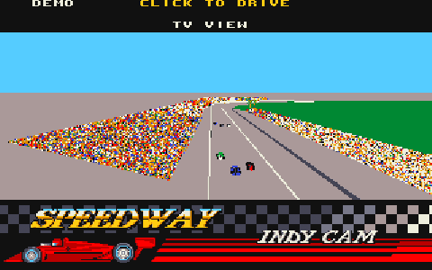

[Watch the full presentation video](media/indianapolis500-demo.mp4) ·
[WebM version](media/indianapolis500-demo.webm)

## Desktop

Go 1.26 or newer and a desktop graphics environment are required.
The runtime assets are included; no preparation step is needed to play.

```sh
go run .
```

Build and run a standalone executable:

```sh
make build
./bin/indianapolis500
```

Useful launch options:

```sh
go run . -fullscreen             # Start in fullscreen mode.
go run . -demo                   # Start the demonstration driver.
go run . -practice               # Start Practice immediately.
go run . -race                   # Start a ten-lap race.
go run . -touch                  # Preview the Android touch layout.
go run . -mute                   # Disable audio.
go run . -scale 4                # Select an initial window scale from 1 to 8.
go run . -data-dir /path/to/data # Select the settings and replay folder.
```

The game preserves the original 320 × 200 image with nearest-neighbor
scaling. Practice, qualifying laps, a rolling race start, car setup pages,
Standings, Lap Info and replay cameras are available from the original menus.

## Controls

| Input | Action |
| --- | --- |
| Arrow keys or WASD | Steer, accelerate, and brake |
| N / B | Original throttle and brake keys |
| Numeric keypad 8 / 2 / 4 / 6 / 5 | Original accelerate, reverse, steering, and brake controls |
| 1–9 | Set turbo boost |
| C | Set cruise control to the current speed; hold to increase the target |
| = / - | Stiffen or soften the front anti-roll bar |
| ] / [ | Stiffen or soften the rear anti-roll bar |
| F1 / F2 | Show Lap Info or Standings |
| I / O / R in Standings | Scroll up, scroll down, or center on your position |
| F3–F10 | Show Fuel, Wings, Rubber, Stagger, Pressures, Shocks, Cambers, or Gears |
| Space / Backspace | Select the next or previous setup component |
| Comma / period | Decrease or increase the selected setup value |
| Ctrl-R | Restart the current event |
| P | Pause or resume |
| Escape | Return to the menu |

A standard gamepad can steer with the left stick or D-pad. The primary button
or right trigger accelerates, the secondary button or left trigger brakes,
Start pauses, and the primary button selects menu items.

During Instant Replay, use Left/Right to change camera, P to pause, and Enter,
Space, Z, or the gamepad primary button to leave. The File menu stores three
independent car setups and one replay. Desktop saves use the platform
configuration directory unless `-data-dir` is supplied.

## Android

The Android build requires Go 1.26+, Java 17 or 21, Android SDK 36,
Android Build Tools 36.0.0 and Android NDK 28.2.13676358. Set `ANDROID_HOME`
or `ANDROID_SDK_ROOT` when the SDK is not installed in a standard location.

Build the ARM64 debug APK:

```sh
make android
```

Build, install and launch on one authorized USB device:

```sh
make android-run
```

The APK is written to:

```text
android/app/build/outputs/apk/debug/app-debug.apk
```

The landscape layout keeps steering and Pause on the left, with throttle
and brake on the right. INFO cycles through the information and setup pages.
When stopped, NEXT selects a component and the minus/plus buttons adjust it.
In the pit box, NEXT chooses fuel or a tire and CHANGE applies the service.
Replays provide camera and Exit buttons. Returning from the background pauses
a manual session; settings and replays use the app's private directory.

## Screenshots

| Official title | Main menu |
| --- | --- |
| 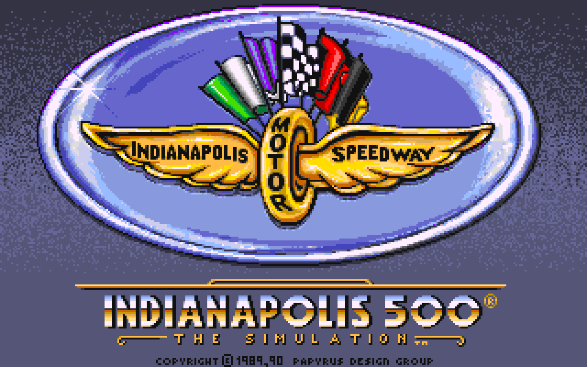 | 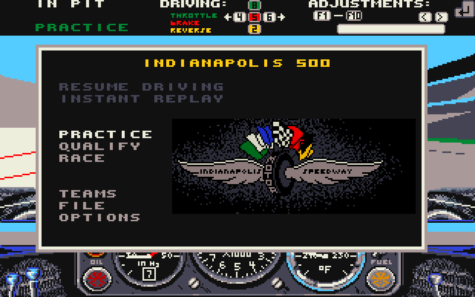 |

| Cockpit | Trackside camera |
| --- | --- |
| 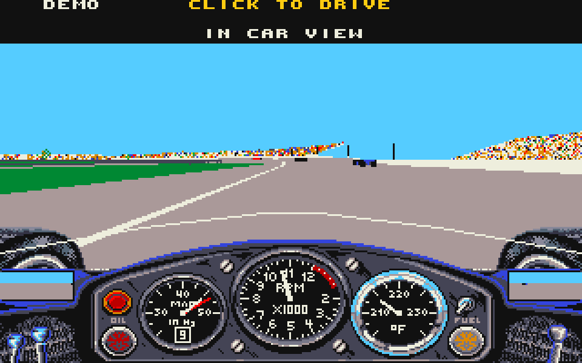 | 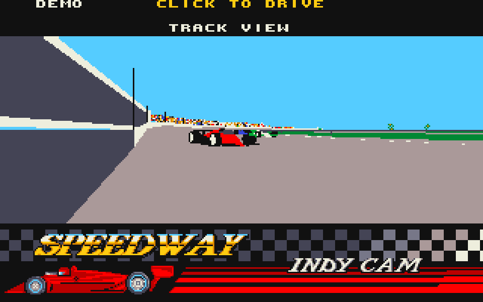 |

| Behind view | Sky view |
| --- | --- |
| 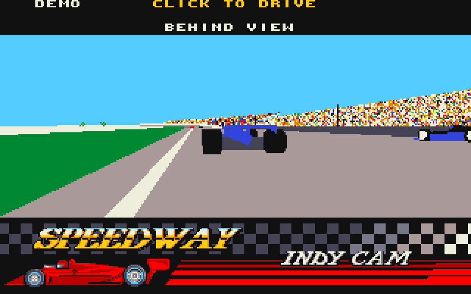 | 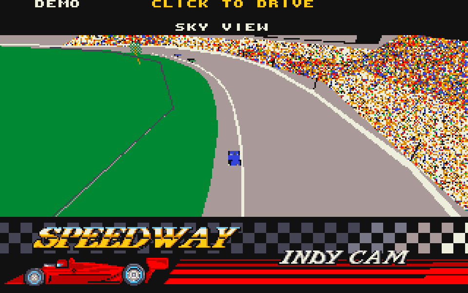 |

| Race standings | Lap information |
| --- | --- |
| 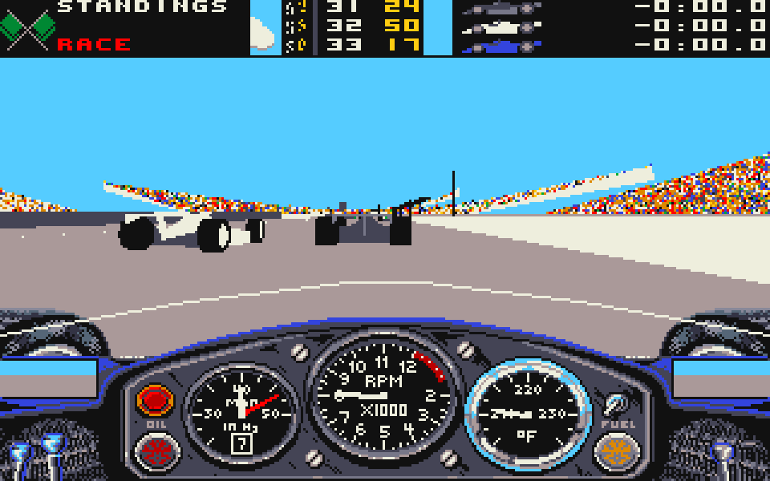 | 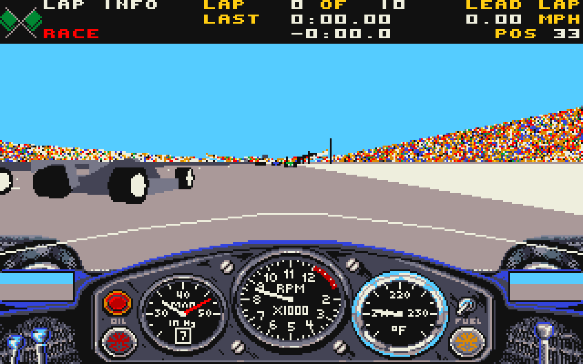 |

| Pit service | Android touch controls |
| --- | --- |
| 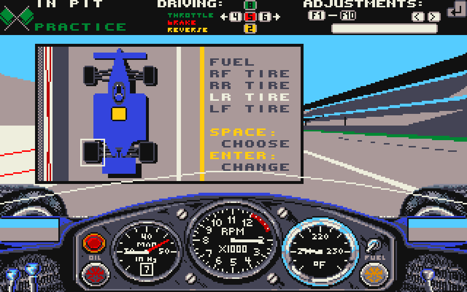 | 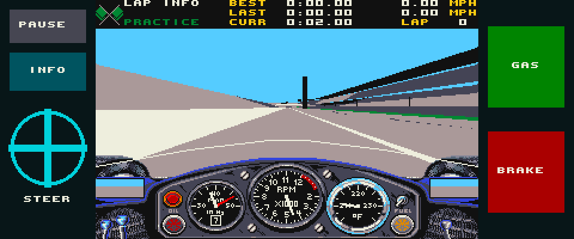 |

## Original game credits

The original game credits name **David Kaemmer** as writer, **Richard Garcia**
for additional programming, **Rich Hilleman** as producer, **Randy Breen** as
associate producer, **Rob Hubbard** for music, **Scott Cronce** as technical
director, and **Wilfredo Aguilar** and **Peggy Brennan** for art.

Indianapolis 500, its name, artwork, game data, and audio remain the property
of their respective rights holders. This independent preservation remake is
not affiliated with or endorsed by them.

No Amiga disk image is distributed in this repository. See [ADF.md](ADF.md)
for the reference version used by the project.
